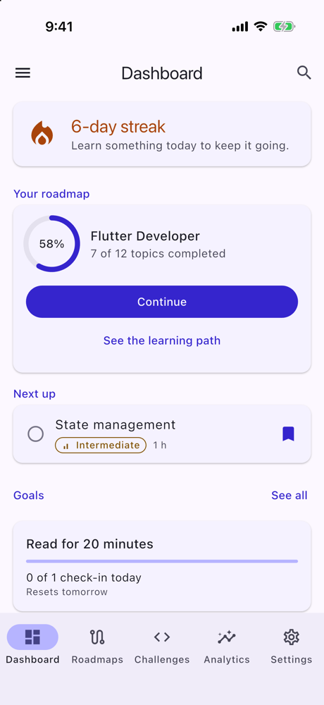
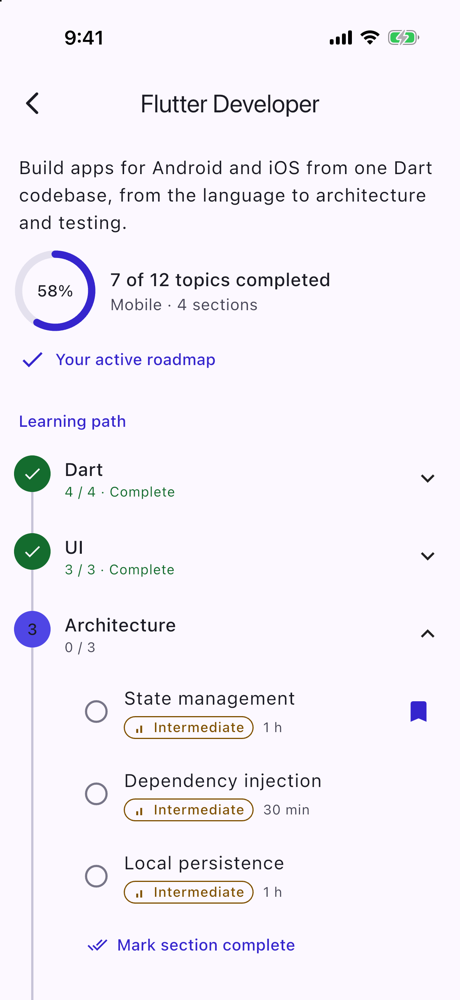
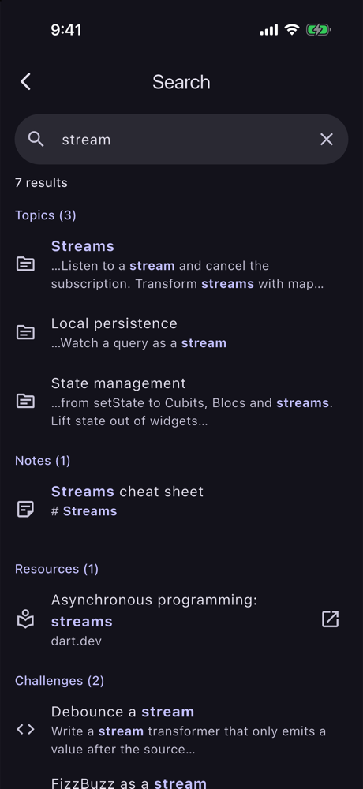
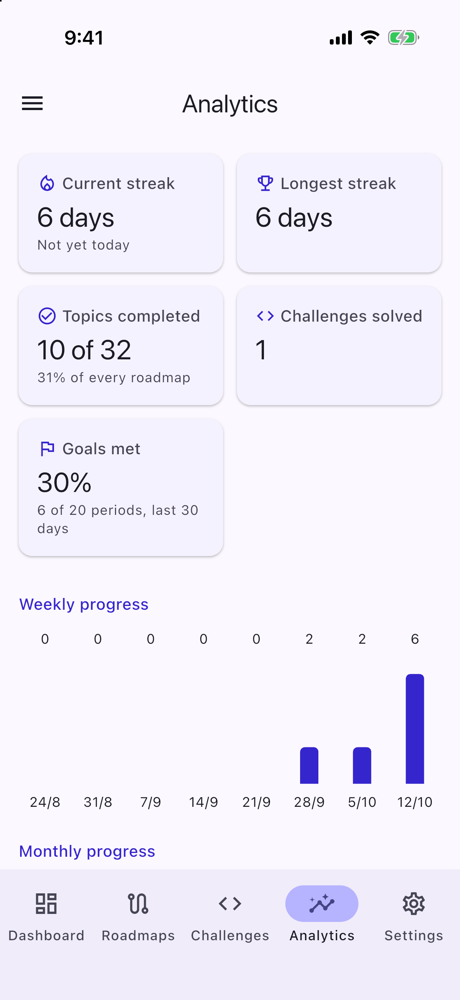

# 🧭 DevJourney (Flutter)

[](https://github.com/MuhammadFaheemAkram/DevJourney-Flutter/actions/workflows/flutter-ci.yml)


A learning-focused, production-inspired **Flutter** app for developers who are learning: follow **roadmaps** broken into sections and topics, track **progress and streaks**, keep **notes**, set **goals**, work through **coding challenges**, save **resources**, **search** everything and read your **analytics**. It is built with **Flutter 3.47**, **Dart 3.13** and a clean, layered architecture, and runs on **Android and iOS**.

DevJourney is **offline-first**: a fake learning API delivers the catalog (roadmaps, topics, resources, challenges), the app keeps it in a local database, and everything you do (completions, notes, goals, bookmarks) stays on the device. There is **no API key and no server**.

> **Why this repo exists**
>
> It is the Flutter edition of an app that also exists natively for [Android](https://github.com/MuhammadFaheemAkram/DevJourney) and [iOS](https://github.com/MuhammadFaheemAkram/iDevJourney). This edition follows the **Android** one closely (its Jetpack Compose UI is already Material 3) and adapts to iOS where the platform has its own conventions. It focuses on:
> - a **synced catalog** kept apart from **user-owned state**, so a sync never loses progress;
> - **progress, streaks and goals derived** from completion dates, never stored;
> - **full-text search** with SQLite FTS5, behind a debounced, restartable Bloc;
> - **platform integration:** daily reminders, dynamic color on Android 12+, in-app browsing, adaptive widgets;
> - typed `go_router` navigation with a tab bar *and* a navigation drawer, code-generated DI, and a test suite that includes an accessibility tour.
>
> Each phase ships with a beginner-to-intermediate friendly write-up in [`docs/`](docs/) that also shows how the Android and iOS editions approached the same feature.

---

## 📋 Project Status

DevJourney is built in **strict, reviewable phases**. Each phase ends with:
- a building app (Android + iOS);
- a clean analyzer and passing tests;
- a summary doc;
- exactly one commit.

| Phase | Scope | Status |
|------:|-------|:------:|
| 1 | Foundation: FVM project, design system base, typed routes with an onboarding gate, 5-tab shell with a navigation drawer, CI | ✅ Done |
| 2 | Data models, drift store, the fake learning API and the catalog; Welcome | ✅ Done |
| 3 | Roadmaps, the learning path, topics and the Dashboard | ✅ Done |
| 4 | Notes (Markdown) and goals | ✅ Done |
| 5 | Challenges, resources and global search (FTS5) | ✅ Done |
| 6 | Analytics, settings and daily reminders | ✅ Done |
| 7 | Documentation, screenshots, community files and CI | ✅ Done |

---

## ✨ Features

- 🚀 **First launch:** fetch the catalog, pick a roadmap, or explore with demo progress
- 📊 **Dashboard:** your streak, the active roadmap and its progress, today's goals, the next topic to learn, recent notes and challenges
- 🗺️ **Roadmaps:** progress per roadmap, search and category filters, pull to refresh syncs the catalog
- 🧱 **Learning path:** sections and topics on a path, expand and collapse, complete a whole section
- 📖 **Topics:** objectives, difficulty, estimated time, resources and notes; complete and bookmark
- 📝 **Notes:** Markdown, attached to topics, searchable, delete with Undo
- 🎯 **Goals:** daily, weekly and monthly, counted from your completions or by check-ins
- 🧩 **Challenges:** difficulty and status filters, hints, solution notes
- 📚 **Resources:** articles, videos, docs and courses; bookmarks; opened in an in-app browser
- 🔎 **Search:** everything at once, ranked, with the matches highlighted
- 📈 **Analytics:** streaks, weekly and monthly progress, completion per roadmap, an activity heatmap
- ⚙️ **Settings:** appearance, dynamic color (Android 12+), a daily reminder at your time, reset progress
- ♿ **Accessible:** dark mode and large text on every screen, labelled controls, checked by a test tour that grows with the app

---

## 📸 Screenshots

| Dashboard | Learning path | Search (dark) | Analytics |
|:---:|:---:|:---:|:---:|
|  |  |  |  |

More, in light, dark, large text and Android dynamic color: [docs/SCREENSHOTS.md](docs/SCREENSHOTS.md).

---

## 🧰 Tech Stack

Packages arrive in the phase that first needs them.

| Area | Choice | Since |
|------|--------|:-----:|
| Toolchain | Flutter 3.47.6 · Dart 3.13, pinned per project with [FVM](https://fvm.app) (`.fvmrc`) | 1 |
| Platforms | Android · iOS 15+ | 1 |
| UI | [`material_ui`](https://pub.dev/packages/material_ui): Material 3 as a standalone package; adaptive widgets on iOS where it matters | 1 |
| Navigation | `go_router` + `go_router_builder` (typed routes, `StatefulShellRoute`, an onboarding `redirect`) | 1 |
| Dependency injection | `get_it` + `injectable` (a code-generated composition root) | 1 |
| State management | `flutter_bloc`: Cubits, and one Bloc (`SearchBloc`) where typing needs a debounced, restartable event stream (`bloc_concurrency`) | 2, 5 |
| Models | `freezed` (domain models, states) + `json_serializable` (the API's DTOs, `checked: true`) | 2 |
| Database | `drift` + `drift_flutter` (SQLite): the catalog and the user's data, with foreign keys, `CHECK` constraints, indexes and exported schema versions | 2 |
| Preferences | `shared_preferences` (`SharedPreferencesWithCache`, loaded before `runApp`) | 2 |
| Time | `clock` (an injected `Clock`: "today" decides streaks, goal periods and demo dates); `intl` (`DateFormat`) | 2–3 |
| Streams | `stream_transform` (`switchMap` to follow the active roadmap, `combineLatest` for the Dashboard) | 3 |
| Adaptive UI | `cupertino_ui` (iOS alerts through `AlertDialog.adaptive`), `RefreshIndicator.adaptive` | 3 |
| Markdown | [`flutter_markdown_plus`](https://pub.dev/packages/flutter_markdown_plus) (the maintained successor of `flutter_markdown`), styled from the app theme | 4 |
| Text | `characters` (length limits that count what the user sees: "👩‍💻" is one character) | 4 |
| Search | SQLite **FTS5** through drift (`search.drift`): a virtual table kept current by triggers, `bm25` ranking, `highlight()` / `snippet()` | 5 |
| Links | `url_launcher` (`LaunchMode.inAppBrowserView`: Custom Tabs on Android, SFSafariViewController on iOS), behind a `LinkOpener` interface, https only | 5 |
| Charts | [`fl_chart`](https://pub.dev/packages/fl_chart) (weekly and monthly bars); the activity heatmap is a `CustomPainter` | 6 |
| Reminders | `flutter_local_notifications` (one repeating, zoned daily notification) + `timezone` + `flutter_timezone`; `app_settings` (the system's notification settings) | 6 |
| Dynamic color | `dynamic_color` (the wallpaper's palette, Android 12+ only) | 6 |
| App info | `package_info_plus` (the version in About) | 6 |
| Lints / CI | `flutter_lints` + strict analyzer modes; GitHub Actions | 1 |
| Testing | `flutter_test`, `bloc_test`, `mocktail`, `fake_async` (the search debounce in fake time) | 1+ |


---

## 🏛️ Architecture

A clean, layered architecture with a one-directional data flow:

```
lib/
├── app/        → root widget (the app-wide SettingsCubit, MaterialApp.router, themes)
├── core/       → design system, navigation, the fake learning API, database (drift + FTS5), storage, platform services
├── data/       → repository implementations + mappers
├── domain/     → models, pure calculations (streaks, goals, analytics, search), contracts, services, use cases (pure Dart)
├── features/   → one folder per screen (Page + View + Cubit/Bloc)
└── di/         → composition root (get_it + injectable)
```

**Data flow:**

```
View ─intent─▶ Cubit ─▶ UseCase ─▶ Repository ─▶ drift ◀── watch() streams ── Cubit ─▶ state ─▶ View
FakeLearningService (bundled JSON, 700 ms) ─▶ CatalogRepository.sync() ─▶ drift catalog tables (one upsert transaction)
                                             CatalogRepository.loadDemoProgress() ─▶ drift user tables (one transaction)
```

**Navigation:**

```
GoRouter ── redirect: onboardingRedirect(onboarded, location)   ◀── refreshListenable
  │
  ├─ /welcome          (until the user has started)
  │
  ├─ tab shell         StatefulShellRoute ── MainShell (NavigationBar + navigation drawer)
  │                      /dashboard · /roadmaps · /challenges · /analytics · /settings
  │
  └─ root-level        /roadmaps/:roadmapId, /topics/:topicId, /challenges/:challengeId,
     screens           /notes (+ /new, /:noteId), /goals, /resources, /search, /about
                       → pushed above the tab bar
```

Key rules:
- **The router owns the gate.** No screen navigates after Welcome's choice: it records the choice, and `refreshListenable` re-runs the pure `onboardingRedirect`.
- **Typed routes only:** no string paths in widgets.
- **Tabs and a drawer, as in the Android edition.** The five tabs are a `NavigationBar`; Notes, Goals, Resources, Search and About live in a drawer that slides over the whole screen. Every tab's app bar opens it, and the Dashboard and Roadmaps also have a Search button (one tap on iOS, where drawers are less expected).
- **Screens above the tabs** are pushed on the root navigator, so Back, and the iOS edge swipe, return to the tab with its state intact. Links work: `/topics/flutter-streams` opens the topic with a Close button.
- **Widgets render state; logic lives elsewhere.** Each screen is a Page plus a View.
- **Layer boundaries:** `domain/` is pure Dart, Views never import `data/`, and only `data/` touches the database.

**Who owns what:**

| Data | Source of truth |
|---|---|
| roadmaps, sections, topics, resources, challenges (the catalog) | the fake learning API; cached in drift, refreshed by a sync |
| completions, bookmarks, notes, goals, check-ins, challenge state | drift, on the device (no sync ever writes them) |
| the search index | derived: written only by triggers |
| onboarded, the active roadmap, the catalog version, appearance, dynamic color, the reminder, recent searches | `SharedPreferencesWithCache` |

---

## 🗂️ Folder Structure

```
DevJourney/
├── .fvmrc                          # pinned Flutter version (3.47.6)
├── .github/                        # workflows/flutter-ci.yml, issue and PR templates
├── analysis_options.yaml           # lints + strict analyzer modes
├── build.yaml                      # lint-free generated files; drift options (FTS5, json1, make-migrations)
├── lib/
│   ├── main.dart                   # binding → configureDependencies() → runApp
│   ├── app/                        # DevJourneyApp: the app-wide SettingsCubit, themes, the router, the reminder refresh
│   ├── core/
│   │   ├── design_system/          # theme/ (AppTheme, AppColors, tokens), formatting/ (labels, dates), widgets/ (roadmap,
│   │   │                           #   topic, note, goal, challenge and resource cards, NoteMarkdown, HighlightedTextView,
│   │   │                           #   ActivityHeatmap, AnalyticsCard, SegmentedChoice, sheets, the adaptive dialog), large_text
│   │   ├── navigation/             # app_routes (+ .g.dart), app_router, onboarding_redirect, stream_listenable, Close fallback
│   │   ├── network/                # LearningService + FakeLearningService, NetworkSimulator, CatalogPublisher,
│   │   │                           #   FakeApiDeveloperTools, dto/, asset_json_loader
│   │   ├── storage/                # settings_local_data_source (SharedPreferencesWithCache)
│   │   ├── database/               # app_database (drift v2) + .steps.dart, search.drift (FTS5 + triggers), converters, tables/,
│   │   │                           #   daos/ (catalog, learning, notes, goals, challenges, resources, search, user data)
│   │   ├── platform/               # UrlLauncherLinkOpener, LocalNotificationsReminderScheduler, MaterialYouColorSource
│   │   └── common/                 # Result, AppException, guardWrite, firstValue, IdGenerator
│   ├── data/                       # mapper/ (API → rows, rows → models, search highlights), repository/
│   ├── domain/                     # model/, calculation/ (recommendation, streak, goals, analytics, fts_query, validation,
│   │                               #   markdown_preview, reminder), repository/, service/, usecase/
│   ├── features/                   # welcome, shell (tabs + drawer), dashboard, roadmaps, roadmap_detail, topic_detail,
│   │                               # notes, note_editor, goals, challenges, challenge_detail, resources, search,
│   │                               # analytics, settings, about
│   └── di/                         # injection.dart (+ .config.dart), app_module.dart
├── assets/json/                    # the fake API's responses: catalog_v1.json, catalog_v2.json, demo_progress.json
├── drift_schemas/                  # every exported schema version (drift_dev make-migrations)
├── docs/                           # architecture, data model, learning engine, API simulation, testing, notes,
│                                   #   screenshots, roadmap, and a write-up per phase
└── test/                           # mirrors lib/, plus app/ (flows, the accessibility tour), drift/ (migrations), helpers/
```

---

## ▶️ How to Run

Prerequisites:
- [FVM](https://fvm.app);
- Xcode, for iOS;
- the Android SDK, with Java 17+ (Android Studio's bundled JDK works).

```bash
fvm install            # installs the version pinned in .fvmrc (3.47.6)
fvm flutter pub get
fvm flutter run        # pick an Android emulator or an iOS simulator
```

Generated code (`*.g.dart`, `*.config.dart`) is committed, so the app runs straight after cloning. After changing annotated code, regenerate it:

```bash
fvm dart run build_runner build
```

On first launch the app fetches the learning catalog (four roadmaps, 32 topics, 35 resources, 12 challenges), then asks which roadmap to start with: **Start learning** fresh, or **Explore with demo progress** (completions, notes, goals and challenge status over the last three weeks). The choice is saved: the next launch opens on the Dashboard.

---

## 🌐 How the Fake API and Sync Work

There is no server. `FakeLearningService` is the app's only "remote" API:
- **Production-shaped:** an abstract `LearningService`, typed DTOs (`json_serializable`, `checked: true`) in the nested shape a real API would use (roadmaps → sections → topics), and `AppException`s, so a real client could replace the fake without changing any caller.
- **The network is simulated:** `NetworkSimulator` waits 700 ms and can fail every request, as if offline. Welcome shows the error, with **Try again**.
- **Checked before writing:** unique ids, non-blank titles, positive durations, `https` URLs, resources pointing at real topics. Broken content fails with "The learning content looks damaged" before anything is written.
- **The sync is an upsert, in one transaction:** new content is inserted, existing content updated in place by its stable id, and the user's tables are never touched. It uses `INSERT … ON CONFLICT DO UPDATE`, never `INSERT OR REPLACE`: SQLite's `REPLACE` deletes the old row first, and that delete would cascade to the user's progress and notes. A test pins it.
- **Developer switches** (Settings → Developer, in memory): **Simulate network failure**, and **Publish a catalog update**, after which the fake API serves `catalog_v2.json` (a new System Design section, an Accessibility topic, three resources, one edited description). Sync from Settings or Roadmaps: "3 new topics, 3 new resources", and roadmap percentages drop as they should.
- **Demo progress has relative dates** (`daysAgo`), resolved against today when it loads, so the demo always shows a live streak.

## 💾 How Local Persistence Works

- **Schema v2 (Phase 5)** adds the search index (see below). The upgrade from v1 is a tested `stepByStep` migration that creates the index and its triggers and indexes the rows already there; every exported version lives in [`drift_schemas/`](drift_schemas/), and the generated tests check each upgrade path ends in exactly the schema a fresh install creates.
- **Schema v1:** the catalog (`roadmaps`, `roadmap_sections`, `topics`, `resources`, `challenges`) and the user's tables (`topic_progress`, `topic_bookmarks`, `resource_bookmarks`, `notes`, `goals`, `goal_check_ins`, `challenge_states`), keyed by catalog ids. Foreign keys are on (`PRAGMA foreign_keys = ON`), and the schema is exported to [`drift_schemas/`](drift_schemas/) from the first version.
- **Days are `CalendarDate`s** (`yyyymmdd` integers) taken from the local clock when the action happens, so a streak counts the user's days; instants are UTC text, for ordering.
- **Nothing derived is stored:** no percentage, count or streak column exists. Roadmap progress is a `LEFT JOIN … GROUP BY` over topics and completions, recomputed whenever either changes.
- **Preferences** live in `SharedPreferencesWithCache`, loaded before `runApp`, so the router knows at once whether to open Welcome or the Dashboard.

Every table, constraint and index: [docs/DATA_MODEL.md](docs/DATA_MODEL.md).

## 🧭 How Progress, the Path and Streaks Work

- **A learning path is one query:** the roadmap, its sections, their topics, and the user's completions and bookmarks, joined (`LEFT JOIN`s, ordered) and folded into a tree in Dart. Completing a topic re-runs it, so the checks, the section counts and the percentage always agree.
- **Completing is idempotent:** one row per topic (`INSERT OR IGNORE`), with the day it happened. Completing a section completes only its open topics, today; topics done earlier keep their days. Uncompleting deletes the rows.
- **What's next:** the first topic not yet completed, in section order, then topic order. A topic skipped earlier comes back first.
- **The streak:** a day counts if the user completed a topic or a challenge, or checked in on a goal (one `UNION` query). The current streak counts back from today, or from yesterday if today has no activity yet: it isn't broken until the day ends. One missed day breaks it. Days are calendar days, so month and year ends can't.
- **The Dashboard** follows the active roadmap with `switchMap` (choosing another swaps the query) and combines its path, the active days and the totals with `combineLatest`, so a completion anywhere updates it at once.
- **Platform touches:** the confirmation before completing a section is a Material dialog on Android and an iOS alert on iOS (`AlertDialog.adaptive`); pull to refresh uses each platform's spinner (`RefreshIndicator.adaptive`).

## 📝 How Notes and Goals Work

- **Notes** are Markdown, optionally attached to a topic (`SET NULL` if the catalog ever drops it). The list is one live query, newest edit first, joined to the topic's title; search is a `LIKE` over titles and contents with `%`, `_` and `\` escaped, so "50%" finds "50%". Previews are plain text, with code blocks left out.
- **The editor** keeps the draft in its Cubit, so the Edit and Preview tabs show the same text and the discard guard (`PopScope`) knows whether anything changed. An untouched note just closes; an empty new note is discarded rather than saved.
- **Undo restores the same note:** deleting returns the row (`DELETE … RETURNING`), and Undo inserts it back with its id and both timestamps. A swiped row leaves the list at once (a dismissed `Dismissible` must leave the tree in the same frame); deleting from the editor closes it, and the screen underneath offers Undo.
- **Markdown in our theme:** `flutter_markdown_plus` reads `package:flutter/material.dart`'s `Theme`, which never sees `material_ui`'s, so it would draw dark text on a dark page. The app hands it a complete style sheet built from its own theme, and a dark-mode test checks the rendered color.
- **Goals are targets per period:** daily (today), weekly (the ISO week, Monday to Sunday) or monthly (the calendar month). Nothing is stored but the goal and its check-ins: progress is the number of topic completions, challenge completions or check-ins whose day falls in the current window, so it **resets by itself** when the window moves.
- **Check-ins** are for custom goals only, and stop at the target (the use case refuses more). Undo removes the latest check-in of the *current* window, never an earlier one.
- **Everything is live:** goal progress combines the goals with one `UNION ALL` of every completion and check-in, so completing a topic on a roadmap moves the topic goals, the Dashboard and the streak together.
- **Platform touches:** the discard guard and delete confirmations are iOS alerts on iOS; the editor is a full-screen dialog (Material's counterpart of an iOS sheet).

## 🔎 How Search Works

- **One FTS5 index for everything** (`search.drift`): `search_index(kind, ref_id, title, body)`, where `kind` and `ref_id` say what a row points at (not searchable), and `title` and `body` are the text (a topic's description and objectives, a note's Markdown, a resource's source, a challenge's prompt; hints are left out, so searching for an answer doesn't surface it).
- **Triggers keep it current:** every insert, update and delete on roadmaps, topics, notes, resources and challenges updates the index in the same statement, whoever writes (a sync, a note saved, Undo). drift reads the triggers too, so a watched search re-runs when a note changes.
- **Safe queries:** `ftsQuery` turns what the user typed into an FTS5 query where each word is a quoted string (so `AND`, `NEAR`, `*`, `-`, quotes and parentheses mean nothing), all words are required, and the last one is a prefix ("strea" finds "streams").
- **Ranked and highlighted:** `bm25` weighs a match in the title ten times one in the body; `highlight()` and `snippet()` mark the matched words, which the app splits into ranges and shows in bold (not color alone).
- **`SearchBloc`, the one Bloc:** typing is debounced (300 ms) and **restartable**, so a newer query cancels the older one's live results. Fewer than two characters show the five recent searches (kept in preferences); opening a result remembers the query.
- **Links open in the app, https only:** resources and links in notes go through `OpenLinkUseCase`, which refuses anything but `https` before the platform sees it, then a `LinkOpener` shows the page in Custom Tabs (Android) or SFSafariViewController (iOS).

## 🧩 Challenges and Resources

- **Challenges:** filter by level and status; each has a prompt, hints revealed one at a time, a status (To do → In progress → Done) and **solution notes saved as you type** (after an 800 ms pause, and at once when you leave). Done records the day: it counts for the streak and challenge goals, and moving it back clears the day.
- **Resources:** search, type chips and **Saved only**; a bookmark toggle on each card. A topic lists its resources too.

## 📈 Analytics, Settings and Reminders

- **Analytics is derived, live:** the same `UNION ALL` of dated events that goals use feeds pure functions: topics per ISO week (8 weeks) and per month (6 months), events per day (a 26-week heatmap), the streaks, and the **goal completion rate** over 30 days. A goal's period counts once it has ended (met or not), or once it's met; the current period isn't a miss yet, and periods before the goal existed don't count. Every chart has a written summary for screen readers.
- **Appearance:** System, Light or Dark (a radio list at large text), applied app-wide by a `SettingsCubit` above `MaterialApp.router` and read before the first frame, so it never flashes. **Dynamic color** builds the scheme from the wallpaper's color on Android 12+; the switch isn't shown where the device has no palette (iOS).
- **The daily reminder is one repeating notification** at a local time, scheduled with `flutter_local_notifications` in the device's time zone (`DateTimeComponents.time`), so it rings every day without the app running and survives reboots (the boot receiver). It's inexact on Android: a nudge doesn't need an exact-alarm permission.
  - **Turning it on asks for permission** (Android 13+, iOS). Denied, the switch stays off and Settings explains where to allow notifications, with a button to the system's notification settings.
  - **At launch and on resume** the app reschedules it in the current time zone, and turns the setting off if permission was revoked, so it never reads "on" while nothing can ring.
  - The time picker is the platform's: Material's clock on Android, a wheel in a sheet on iOS.
- **Reset progress** clears completions, bookmarks, goal check-ins and challenge work in one transaction; notes, goals, the catalog and settings stay. It asks first (an iOS alert on iOS).
- **About** shows the version (`package_info_plus`), the open-source licenses and the editions on other platforms.

**Platform setup:** Android enables core library desugaring and declares `POST_NOTIFICATIONS`, `RECEIVE_BOOT_COMPLETED` and the plugin's receivers; iOS sets the notification center's delegate in `AppDelegate`, so a reminder shows while the app is open.

---

## ✅ Testing

```bash
fvm flutter analyze
fvm dart format --output=none --set-exit-if-changed .
fvm flutter test
```

**534 tests**, all on every push:

| Area | Tests |
|---|---:|
| Domain: streaks, goals, analytics series, `ftsQuery`, validation, use cases (figures worked out by hand) | 111 |
| Accessibility tour: every screen and state, light and dark, 200 % text | 77 |
| Cubits and `SearchBloc` on the real data stack (debounce in fake time) | 67 |
| Views with mocked Cubits | 64 |
| Design system: themes, WCAG contrast, widgets, Markdown colors | 61 |
| DAOs and SQL, FTS5 and its triggers | 37 |
| Repositories (user data surviving a re-sync, Undo, settings) | 33 |
| Navigation | 30 |
| App-level flows on the real DI graph | 27 |
| Catalog, demo data and the fake service | 19 |
| drift migrations | 4 |
| DI | 1 |

Eleven key behaviours were broken on purpose to prove the tests catch them. Details, helpers and gotchas: [docs/TESTING.md](docs/TESTING.md).

CI (`.github/workflows/flutter-ci.yml`) runs on every push to `main` and every pull request. It installs the FVM-pinned Flutter, checks that the committed generated code is up to date, then runs format, analyze and test.

---

## 📱 Same App on Other Platforms

| Edition | Stack | Repo |
|---------|-------|------|
| Android | Kotlin · Jetpack Compose · Hilt · Room · DataStore · WorkManager | [MuhammadFaheemAkram/DevJourney](https://github.com/MuhammadFaheemAkram/DevJourney) |
| iOS | Swift 6 · SwiftUI · SwiftData · Swift Charts | [MuhammadFaheemAkram/iDevJourney](https://github.com/MuhammadFaheemAkram/iDevJourney) |
| **Flutter** | Dart · Flutter · Bloc · drift | this repo |

| Concept | Android | iOS | Flutter |
|---|---|---|---|
| UI | Jetpack Compose | SwiftUI | widgets + `material_ui` (adaptive where it matters) |
| Navigation | bottom bar + `ModalNavigationDrawer` | `TabView` + More | `StatefulShellRoute` + `NavigationBar` + a `Drawer` |
| Screen state | ViewModel + StateFlow | `@Observable` | Cubit / Bloc |
| Storage | Room + DataStore | SwiftData + `@AppStorage` | drift + `SharedPreferencesWithCache` |
| Fake API | fake API layer, "sync" | `LearningService` seeds SwiftData | `LearningService` + an upsert sync that never touches user data |
| Search | Flow debounce | debounced | FTS5 (ranked, highlighted) + a debounced, restartable Bloc |
| Charts | custom Compose | Swift Charts | `fl_chart` + a `CustomPainter` heatmap |
| Reminders | WorkManager | UserNotifications | `flutter_local_notifications` (one zoned, daily notification) |
| Dynamic color | Material You | — | `dynamic_color`, Android 12+ only |
| DI | Hilt | `AppEnvironment` | `get_it` + `injectable` |

---

## 📚 Documentation

- [Architecture](docs/ARCHITECTURE.md): layers, state, errors, navigation, DI, platform services, key decisions
- [Data model](docs/DATA_MODEL.md): the catalog and user tables, the FTS5 index, constraints, migrations
- [Learning engine](docs/LEARNING_ENGINE.md): progress, recommendations, streaks, goals and analytics, with worked examples
- [API simulation](docs/API_SIMULATION.md): the fake service, catalog versions, sync rules, developer switches
- [Testing](docs/TESTING.md): what's covered, how, and the mutation checks
- [Learning notes](docs/LEARNING_NOTES.md) and [interview notes](docs/INTERVIEW_NOTES.md)
- [Screenshots](docs/SCREENSHOTS.md) · [Roadmap](docs/ROADMAP.md) · [Changelog](CHANGELOG.md) · [Contributing](CONTRIBUTING.md) · [Security](SECURITY.md)

Phase write-ups, each with an Android / iOS comparison:
- [Phase 1 — Foundation](docs/PHASE_1_SUMMARY.md)
- [Phase 2 — Data Layer](docs/PHASE_2_SUMMARY.md)
- [Phase 3 — Roadmaps + Topics](docs/PHASE_3_SUMMARY.md)
- [Phase 4 — Notes + Goals](docs/PHASE_4_SUMMARY.md)
- [Phase 5 — Challenges + Resources + Search](docs/PHASE_5_SUMMARY.md)
- [Phase 6 — Analytics + Settings + Reminders](docs/PHASE_6_SUMMARY.md)
- [Phase 7 — Documentation & CI](docs/PHASE_7_SUMMARY.md)

---

## 🗺️ Roadmap

All seven phases are done. What could come next (smarter reminders, custom roadmaps, spaced repetition, a real backend, widgets, tablets) is in [docs/ROADMAP.md](docs/ROADMAP.md).

---

## 📄 License

[MIT](LICENSE) © 2026 BitFuse
