# Screenshots

Captured on 2026-10-18 on an **iPhone 17 Pro simulator** (iOS, debug build, status bar fixed at 9:41) and an **Android 16 emulator** (Pixel 10 Pro, for dynamic color), then downscaled to 1000 px tall. Everything on screen is the demo progress, loaded with **Explore with demo progress** on a fresh install: its dates are relative, so it always shows a live streak and this week's goals.

## Light

| Welcome | Dashboard | Learning path |
|:---:|:---:|:---:|
| 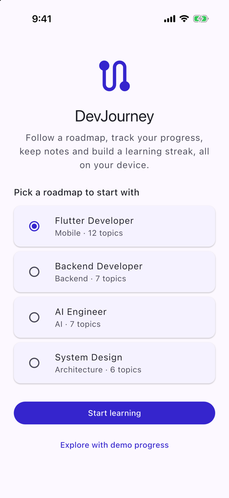 | 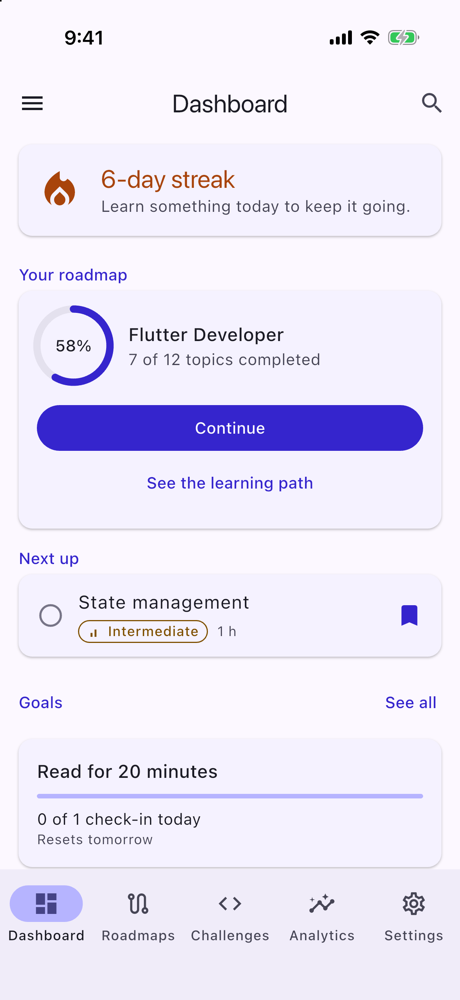 | 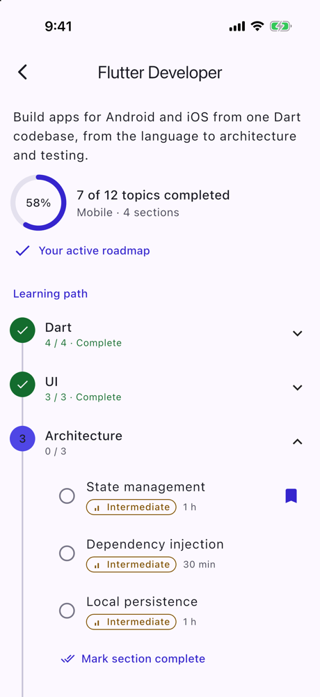 |

| A topic | Challenges | Analytics |
|:---:|:---:|:---:|
| 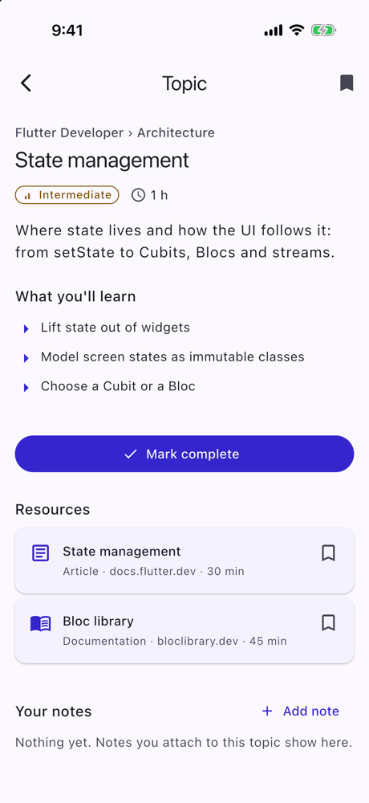 | 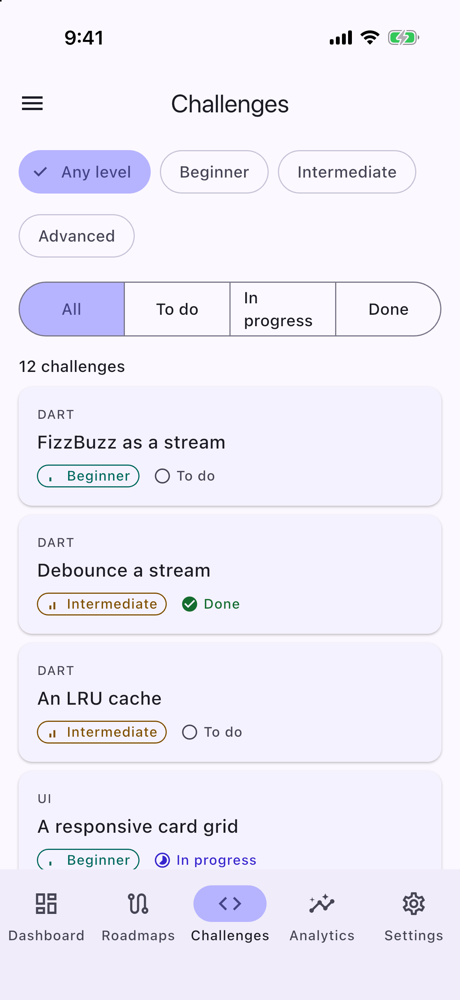 | 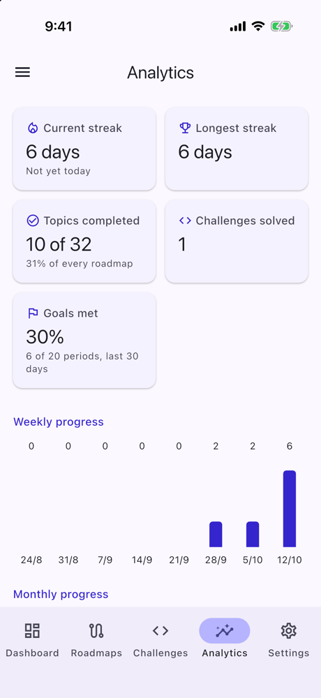 |

| Analytics, scrolled |
|:---:|
| 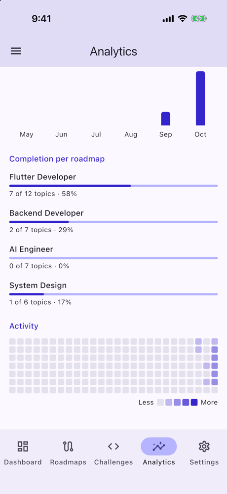 |

## Dark

| Search | A note's Preview | Goals |
|:---:|:---:|:---:|
| 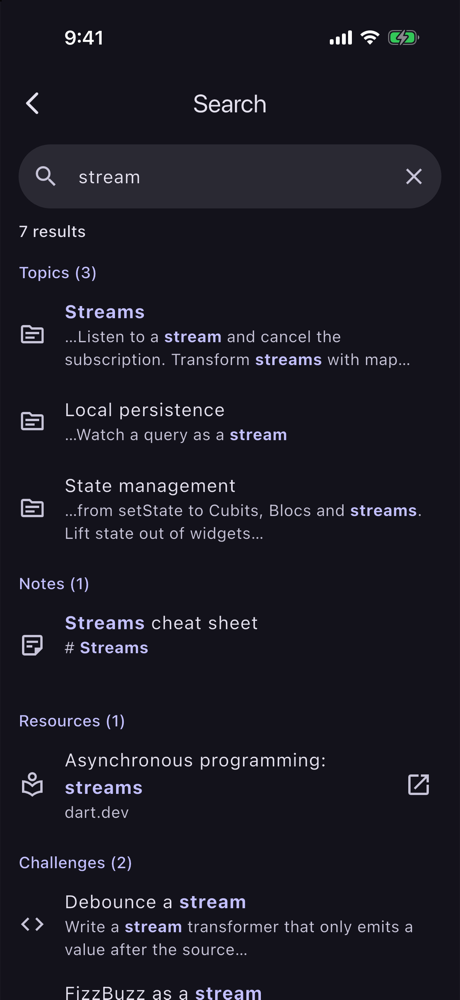 | 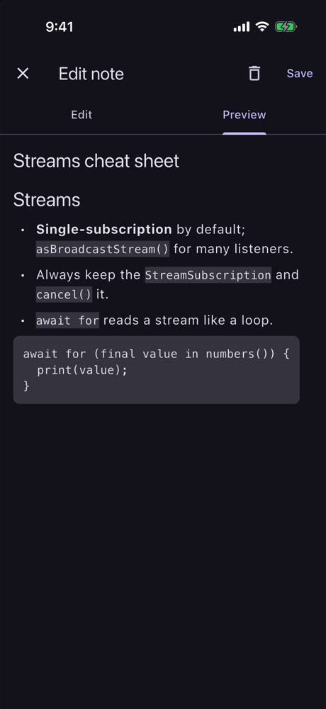 | 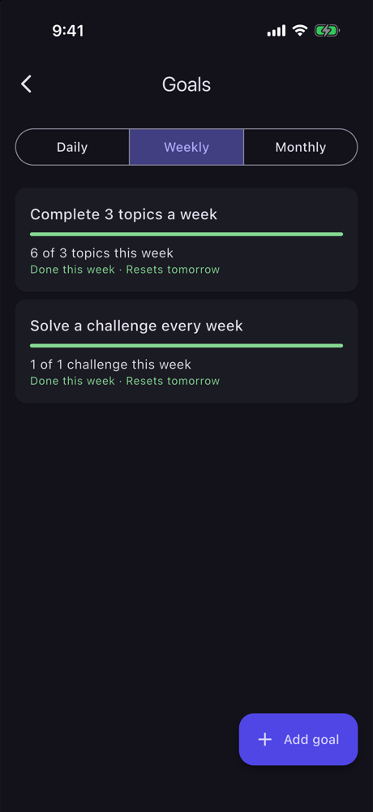 |

| Settings |
|:---:|
| 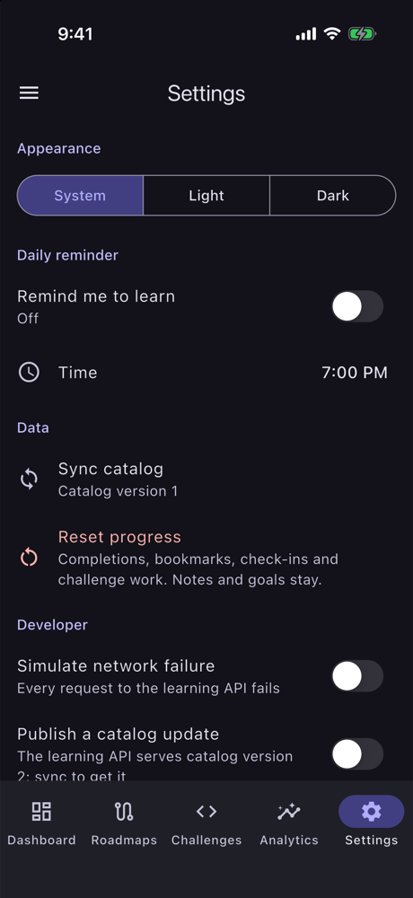 |

## Large text

Accessibility text size **AX3** (about 235 %), dark mode.

| Dashboard | Analytics | Settings |
|:---:|:---:|:---:|
| 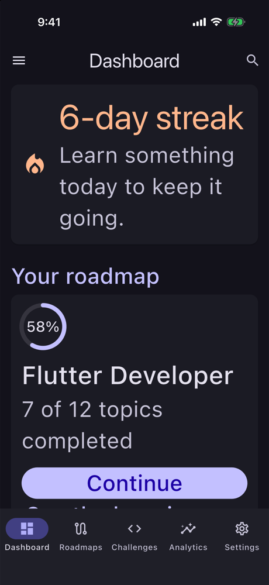 | 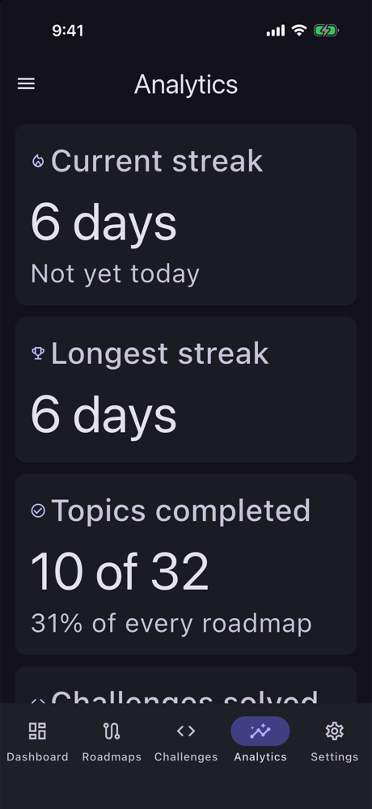 | 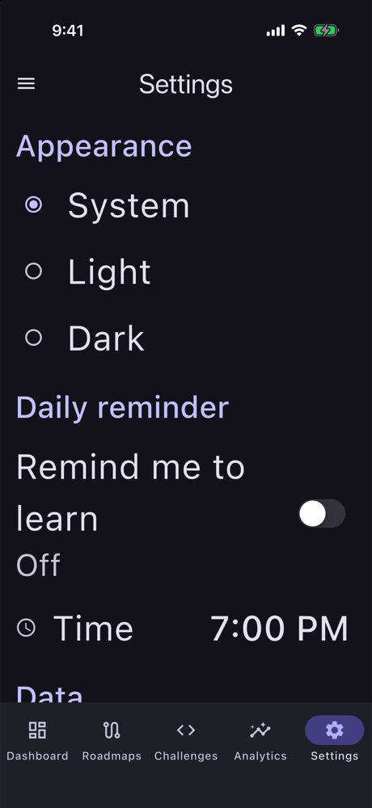 |

## Android, dynamic color

Android 16 emulator, light mode, Dynamic color on: the app takes its colors from the wallpaper instead of its own indigo.

| Dashboard | Settings |
|:---:|:---:|
| 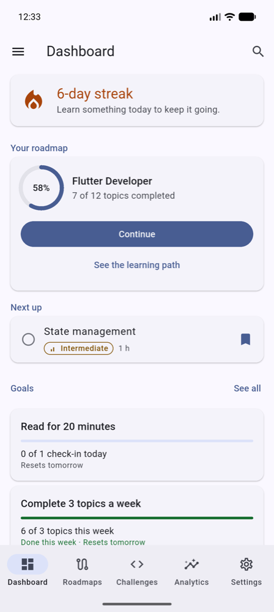 | 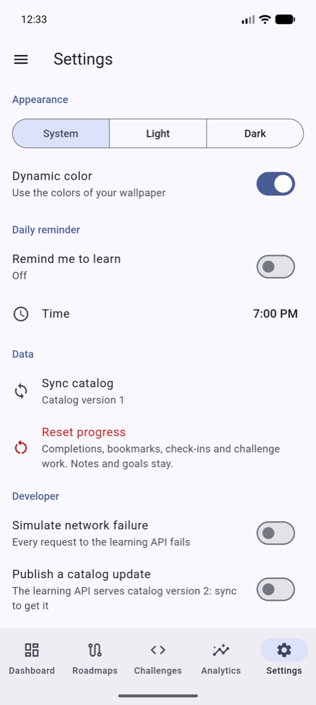 |

## What to look for

- **One set of figures everywhere:** the Dashboard's 7 of 12, the path's sections, Analytics' bars and goals all come from the same completion rows, derived when each screen reads them. Nothing is stored twice.
- **Never color alone:** difficulty has bars in its icon, challenge status an icon and a word, met goals the word "Done", search matches bold text.
- **Search** ranks a title match first (the Streams topic) and groups by kind.
- **The note preview is readable in dark mode** because the Markdown renderer gets the app's own style sheet (conventions §11.55).
- **Platform touches:** iOS switches on iOS, Material switches and wallpaper colors on Android.
- **Large text:** cards stack, segments become radio buttons, and the tab labels keep their size (a long press shows them).

## Retaking them

```bash
fvm flutter build ios --simulator --debug
xcrun simctl uninstall booted co.bitfuse.flutter.devJourney        # a fresh install
xcrun simctl install booted build/ios/iphonesimulator/Runner.app
xcrun simctl launch booted co.bitfuse.flutter.devJourney           # then Explore with demo progress

xcrun simctl status_bar booted override --time 9:41 --dataNetwork wifi --wifiBars 3 --cellularBars 4 --batteryState charged --batteryLevel 100
xcrun simctl ui booted appearance dark                             # or light
xcrun simctl ui booted content_size accessibility-extra-large      # AX3; "large" is the default

xcrun simctl io booted screenshot docs/screenshots/<name>.png
sips -Z 1000 docs/screenshots/<name>.png                           # downscale (macOS)

xcrun simctl status_bar booted clear                               # afterwards
```

On Android: `adb exec-out screencap -p > docs/screenshots/<name>.png`, then the same `sips` step.

The demo's dates follow the device's date, so the day counts and the week's goals change with it.
